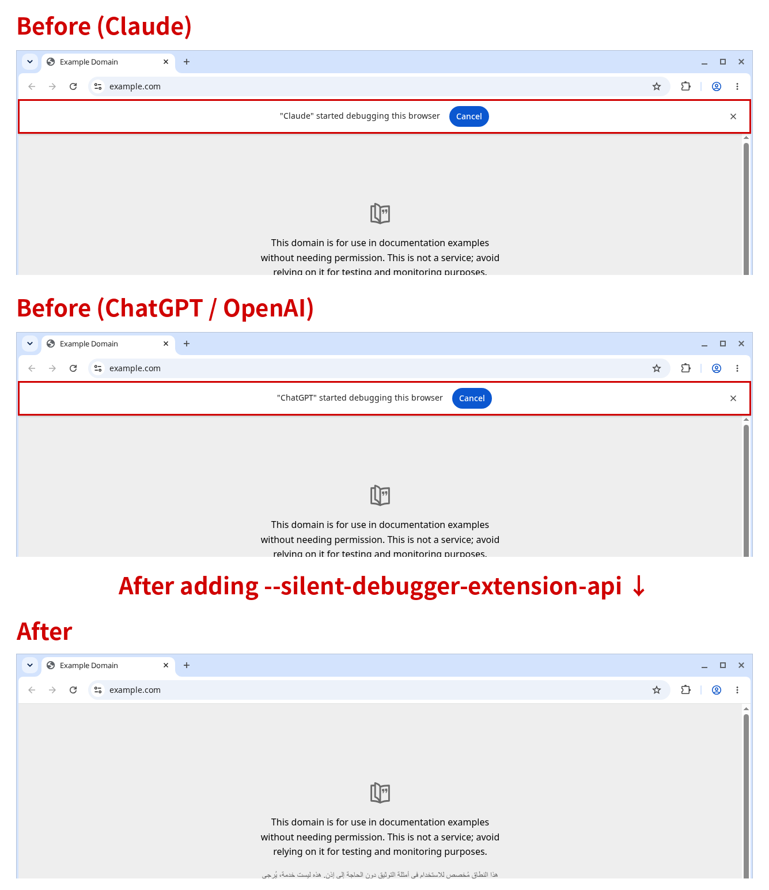

[繁體中文](README.md) | **English**

# chrome-quiet-debugger

Hides Chrome's "started debugging this browser" infobar by launching Chrome with `--silent-debugger-extension-api`. It does not patch the Chrome binary or open a remote debugging port.



These are real Chrome screenshots (English UI). The bars were reproduced with demo extensions named "Claude" and "ChatGPT", not the official Anthropic or OpenAI extensions. OpenAI's official extension display name is [ChatGPT](https://chromewebstore.google.com/detail/chatgpt/hehggadaopoacecdllhhajmbjkdcmajg), not Codex.

The flag hides the bar for **every** extension that uses the debugger API, not only one agent. Use it only if you trust your installed extensions. Do not use it on a shared or managed machine.

For what the installer changes, the no-script method, limits, security notes, and alternatives, see the [detailed notes](docs/DETAILS.en.md).

## Install with an AI agent

Paste this to Claude Code, Codex, Cursor, or a similar agent that can change settings on your computer:

```
Install https://github.com/stantheman0128/chrome-quiet-debugger for me.
Read AGENTS.md in the repo, then follow it for my OS. Do not modify chrome.exe or Google Chrome.app, do not open a remote debugging port, and do not change any extensions. When finished, list every item you changed so I can review it. Only ask me to fully quit and reopen Chrome, and to check chrome://version.
```

## Install manually

### Windows

1. Download the ZIP from [this repo](https://github.com/stantheman0128/chrome-quiet-debugger) and extract it. Fully quit Chrome first (including the notification-area icon).
2. In PowerShell, from that folder:

   ```powershell
   Set-ExecutionPolicy -Scope Process -ExecutionPolicy Bypass
   .\windows\install.ps1
   ```

3. Reopen Chrome.

### macOS

1. Download and extract this repo (or `git clone`). Quit Chrome fully (`Cmd+Q`).
2. In that folder:

   ```bash
   chmod +x mac/install.sh
   ./mac/install.sh
   ```

3. Open Chrome with `~/Applications/Chrome (Quiet Debugger).app` (you can put it in the Dock). Do not use the original Chrome icon.

## How to verify

Open `chrome://version` and check that the Command Line contains `--silent-debugger-extension-api`. Fully quit Chrome and reopen it first.

## Uninstall

Windows (run `Set-ExecutionPolicy -Scope Process -ExecutionPolicy Bypass` first): `.\windows\uninstall.ps1`. macOS: `./mac/uninstall.sh`.

## License

[MIT](LICENSE). Copyright (c) 2026 Stan Shih.
