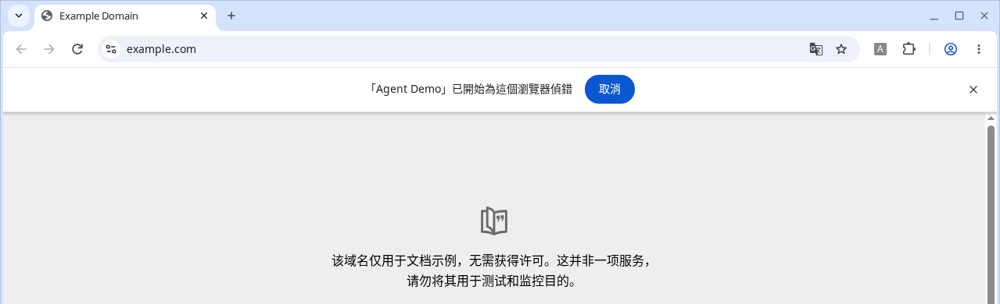
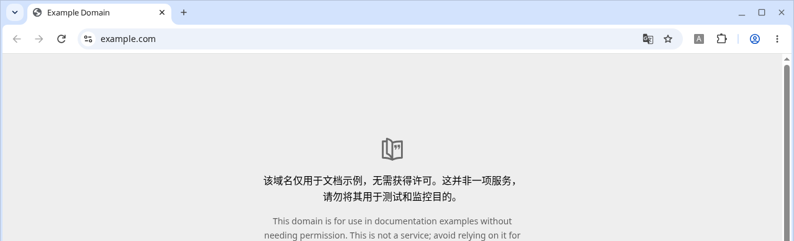
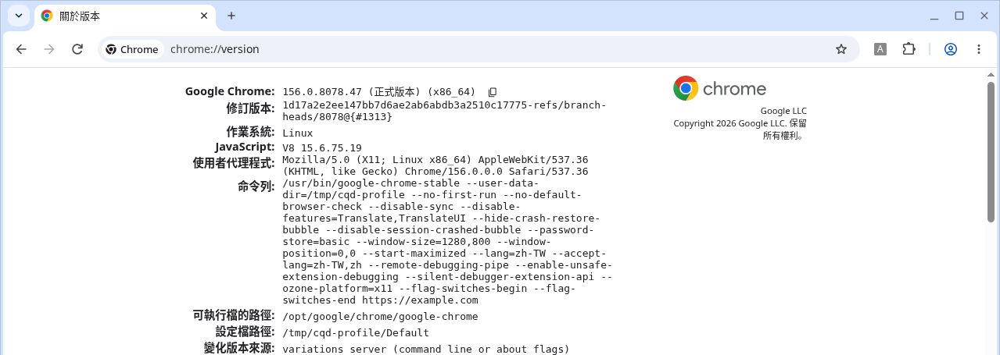

# chrome-quiet-debugger

把 Chrome 那條「已開始為這個瀏覽器偵錯」提示藏起來。

Claude in Chrome、Codex 或其他瀏覽器 agent 透過 `chrome.debugger` 控制網頁時，Chrome 會在視窗上方顯示這條提示。這個工具會讓 Chrome **一律**帶著 Chromium 內建的啟動參數 `--silent-debugger-extension-api` 開啟，提示就不會再出現。

它不會修改 `chrome.exe`、不會開啟遠端偵錯連接埠，也不會更動任何擴充功能。

## 這是什麼問題

實際截圖。Google Chrome 156.0.8078.47（正式版本），測試用設定檔，示範擴充功能名稱為「Agent Demo」。

修改前，網址列下方會出現這條提示（文案為「『Agent Demo』已開始為這個瀏覽器偵錯」，右側有「取消」）：



加上參數後，同一個擴充功能仍然有接上偵錯介面，但提示條不再出現：



在 `chrome://version` 的「命令列」裡，應該看得到 `--silent-debugger-extension-api`：



這三張都是真實的 Chrome 畫面，不是示意圖。截圖時用的是臨時設定檔和示範擴充功能，沒有登入帳號。`chrome://version` 那張命令列裡另外出現的 `--remote-debugging-pipe`、`--enable-unsafe-extension-debugging`，只是為了在官方 Chrome 156 載入示範擴充功能（這個版本會忽略 `--load-extension`），**不是**這個工具會加上的參數。

英文介面的提示大致是：`"Agent Demo" started debugging this browser`，右側有 `Cancel`。擴充功能名稱會依你實際在用的工具而變。

## 它做什麼、不做什麼

**會做**

- Windows：備份後，把啟動參數加到目前使用者桌面、公用桌面、開始功能表（個人與所有使用者），以及工作列釘選的 Chrome 捷徑。同時在 `HKCU` 覆寫 `ChromeHTML`（以及 Beta / Dev / Canary 等類似項目）的開啟指令，讓你點連結開啟 Chrome 時也會帶上這個參數。不需要系統管理員權限。
- macOS：在 `~/Applications` 建立一個名為 `Chrome (Quiet Debugger).app` 的啟動器，用它來開啟 Chrome。

**不會做**

- 不修改 Chrome 的程式檔
- 不開啟 `--remote-debugging-port`
- 不安裝、移除或改設定任何擴充功能
- 不改 `chrome://flags`

同一個參數不會被加兩次。再跑一次安裝是安全的。

## 安裝

### A. 給 AI agent 安裝

把下面這段貼給 Claude Code、Codex、Cursor 或其他能改你電腦設定的 AI agent：

```
請幫我安裝 https://github.com/stantheman0128/chrome-quiet-debugger

這是一個小工具，用來隱藏 Chrome「已開始為這個瀏覽器偵錯」／"started debugging this browser" 提示條。作法是讓 Chrome 啟動時帶上 Chromium 內建的 --silent-debugger-extension-api。請先讀 repo 裡的 AGENTS.md，再依作業系統執行。

規則：
- 不要修改 chrome.exe 或 Google Chrome.app 裡的程式檔
- 不要開啟遠端偵錯連接埠（例如 --remote-debugging-port）
- 不要安裝、移除或更改任何擴充功能
- 做完後列出你改了哪些捷徑或設定，讓我過目

請你自己判斷 Windows 或 macOS 並執行，不要叫我一步一步貼指令。只有「完全結束並重開 Chrome」和「到 chrome://version 確認命令列」這兩步需要我動手時，再告訴我。

步驟：
1. 若這台機器還沒有原始碼，用 git clone https://github.com/stantheman0128/chrome-quiet-debugger.git，或下載並解壓縮該 repo 的 ZIP。
2. 先跑 status（若有的話），再跑 install。
   Windows（PowerShell）：
     Set-ExecutionPolicy -Scope Process -ExecutionPolicy Bypass
     .\windows\status.ps1
     .\windows\install.ps1
     若我想先看會改什麼：.\windows\install.ps1 -WhatIf
   macOS：
     chmod +x mac/install.sh mac/uninstall.sh
     ./mac/install.sh
3. 請我完全結束 Chrome 再重新打開。Windows 用原本的捷徑即可。macOS 請用「Chrome (Quiet Debugger).app」，並建議把它拖到 Dock。
4. 請我打開 chrome://version，確認「命令列」／Command Line 裡有 --silent-debugger-extension-api。
5. 若要解除安裝：Windows 跑 .\windows\uninstall.ps1；macOS 跑 ./mac/uninstall.sh。

補充：
- Windows 通常不需要系統管理員。若「所有使用者」的桌面或開始功能表捷徑更新失敗，請告訴我哪些沒改到。
- macOS 無法改掉「點連結時啟動 Chrome」這條路。若 Chrome 已經完全結束，再點網頁連結，系統仍會用原本的 Google Chrome.app 開啟，參數就不會帶上。請先用啟動器打開 Chrome，之後再點連結。
```

更完整、給 agent 讀的說明在 [AGENTS.md](AGENTS.md)。

### B. 手動安裝

#### Windows

1. 到 [這個 repo](https://github.com/stantheman0128/chrome-quiet-debugger) 按 `Code` → `Download ZIP`，解壓縮。
2. 先完全結束 Chrome（系統匣裡的圖示也要結束）。
3. 在解出來的資料夾打開 PowerShell，執行：

   ```powershell
   Set-ExecutionPolicy -Scope Process -ExecutionPolicy Bypass
   .\windows\install.ps1
   ```

   若你想先看會改哪些項目，把最後一行換成 `.\windows\install.ps1 -WhatIf`。目前狀態可用 `.\windows\status.ps1` 查看。
4. 重新打開 Chrome。
5. 到 `chrome://version`，確認「命令列」裡有 `--silent-debugger-extension-api`。

解除安裝：

```powershell
Set-ExecutionPolicy -Scope Process -ExecutionPolicy Bypass
.\windows\uninstall.ps1
```

備份在 `%USERPROFILE%\chrome-quiet-debugger-backup`。有備份就還原，沒有備份就只把參數拿掉。

如果「所有使用者」的桌面或開始功能表捷徑更新失敗，多半是權限不夠。你自己桌面上的捷徑，以及點連結時用的開啟指令，一般仍會改成功。

**不用腳本的作法：** 在 Chrome 捷徑按右鍵 → `內容`，在「目標」最前面那個 `chrome.exe` 路徑後面空一格，加上 `--silent-debugger-extension-api`。每個會打開 Chrome 的捷徑都要改。改完後完全結束 Chrome 再重開。只改捷徑的話，從連結開啟 Chrome（而且當時 Chrome 是關著的）可能還是不會帶上這個參數；腳本才會一併改登錄檔裡的開啟指令。

#### macOS

1. 下載並解壓縮這個 repo（或 `git clone`）。
2. 在終端機進入該資料夾，執行：

   ```bash
   chmod +x mac/install.sh mac/uninstall.sh
   ./mac/install.sh
   ```

3. 完全結束 Chrome（`Cmd+Q`，不要只關視窗）。
4. 用 `~/Applications` 裡的 `Chrome (Quiet Debugger).app` 打開 Chrome。不要點原本的 Chrome 圖示。
5. 可以把這個啟動器拖到 Dock，之後都從那裡開啟。
6. 到 `chrome://version`，確認命令列裡有 `--silent-debugger-extension-api`。

解除安裝：`./mac/uninstall.sh`。若你有把它放到 Dock，再把圖示拖離 Dock。

**macOS 的限制：** 如果 Chrome 已經完全結束，你再去點一個網頁連結，系統還是會用原本的 `Google Chrome.app` 啟動，這次就不會帶上參數。請先用啟動器打開 Chrome，之後再點連結，就會沿用已經帶參數的那個行程。

**不用腳本的作法：** 先 `Cmd+Q` 結束 Chrome，然後在終端機執行：

```bash
open -a "Google Chrome" --args --silent-debugger-extension-api
```

之後若要常用，再跑 `./mac/install.sh` 做啟動器會比較方便。

## 怎麼確認有沒有成功

完全結束 Chrome 後再打開（Windows 用平常的捷徑；macOS 用啟動器），到 `chrome://version` 看「命令列」（Command Line）。裡面應該要有 `--silent-debugger-extension-api`。

## 安全上的取捨

這條提示是在告訴你：有擴充功能正在透過偵錯介面控制這個瀏覽器。上面的「取消」也可以立刻切斷這種控制。

加上這個參數之後，**所有**使用偵錯 API 的擴充功能都不會再顯示這條提示，不是只針對 Claude 或 Codex。請先確認你安裝的擴充功能都信得過，再使用這個工具。

共用電腦、公司管理的電腦，或你不確定裝了哪些擴充功能時，不要用。

## 其他做法

- [thelabcorner/chrome-silent-debugger](https://github.com/thelabcorner/chrome-silent-debugger) 是類似的 Windows 工具，用的也是同一個啟動參數。
- 比較精準的作法是用企業政策 `ExtensionInstallForcelist` 強制安裝特定擴充功能。走這條路時，Chrome 本來就不會對「被政策強制安裝」的那個擴充功能顯示這條提示。不過要改系統層級的設定（通常需要系統管理員），而且那個擴充功能使用者不能自己移除；公司電腦也可能跟 IT 政策衝突。
- 有人在 Anthropic 的 issue 追蹤裡建議官方提供內建選項：[anthropics/claude-code#69287](https://github.com/anthropics/claude-code/issues/69287)。

## 授權

[MIT](LICENSE)。Copyright (c) 2026 Stan Shih。

---

## English

A small tool that hides Chrome's `"<extension>" started debugging this browser` infobar (in Chrome 156 zh-TW the text is 「『…』已開始為這個瀏覽器偵錯」, with a Cancel button). It does this by launching Chrome with Chromium's own `--silent-debugger-extension-api` switch.

It does not patch `chrome.exe`, does not open a remote debugging port, and does not change any extensions.

The images above are real Chrome 156.0.8078.47 screenshots on a throwaway profile, using a demo extension named "Agent Demo".

### For AI agents

Paste this to Claude Code, Codex, Cursor, or a similar agent:

```
Install https://github.com/stantheman0128/chrome-quiet-debugger for me.

This tool hides Chrome's "started debugging this browser" infobar by launching Chrome with --silent-debugger-extension-api. Read AGENTS.md in the repo, then do the work.

Rules:
- Do not modify chrome.exe or the Google Chrome.app binary
- Do not open a remote debugging port (for example --remote-debugging-port)
- Do not install, remove, or change any extensions
- When finished, list every shortcut or setting you changed

Detect Windows vs macOS and run the installer yourself. Don't ask me to paste commands step by step. Only ask me to fully quit and reopen Chrome, and to check chrome://version.

Steps:
1. Clone https://github.com/stantheman0128/chrome-quiet-debugger.git, or download and extract the repo ZIP.
2. Windows (PowerShell):
     Set-ExecutionPolicy -Scope Process -ExecutionPolicy Bypass
     .\windows\status.ps1
     .\windows\install.ps1
     (preview: .\windows\install.ps1 -WhatIf)
   macOS:
     chmod +x mac/install.sh mac/uninstall.sh
     ./mac/install.sh
3. Ask me to fully quit Chrome and reopen it. On Windows I can use the usual shortcut. On macOS I must use "Chrome (Quiet Debugger).app" (and may pin it to the Dock).
4. Ask me to open chrome://version and confirm the Command Line contains --silent-debugger-extension-api.
5. To uninstall: Windows .\windows\uninstall.ps1 ; macOS ./mac/uninstall.sh.

Notes: Windows usually does not need admin; tell me if all-users shortcuts fail. On macOS, clicking a link while Chrome is fully quit still launches the official Google Chrome.app without the flag — I should start from the launcher first.
```

### Manual install

**Windows:** Download the ZIP, extract, quit Chrome fully, then in PowerShell:

```powershell
Set-ExecutionPolicy -Scope Process -ExecutionPolicy Bypass
.\windows\install.ps1
```

Reopen Chrome and check `chrome://version`. Uninstall with `.\windows\uninstall.ps1`. Backups go to `%USERPROFILE%\chrome-quiet-debugger-backup`.

Without the script: edit each Chrome shortcut's Target and append `--silent-debugger-extension-api` after `chrome.exe`.

**macOS:** Run `./mac/install.sh`, quit Chrome with `Cmd+Q`, open `Chrome (Quiet Debugger).app` from `~/Applications`, and optionally put it in the Dock. Uninstall with `./mac/uninstall.sh`.

Without the script:

```bash
open -a "Google Chrome" --args --silent-debugger-extension-api
```

Limitation: if Chrome is fully quit and you then click a link, macOS starts the official app without the flag. Open the launcher first.

**Verify:** `chrome://version` Command Line must contain `--silent-debugger-extension-api`.

**Security:** the flag hides the infobar for *all* extensions that use the debugger API, not only one agent. Use it only if you trust the extensions you already have installed. Do not use it on a shared or managed machine.

See also [thelabcorner/chrome-silent-debugger](https://github.com/thelabcorner/chrome-silent-debugger), the `ExtensionInstallForcelist` policy approach, and [anthropics/claude-code#69287](https://github.com/anthropics/claude-code/issues/69287).

MIT license, copyright Stan Shih.
