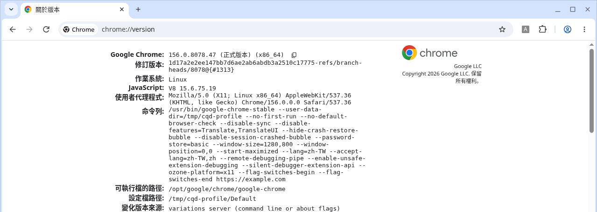

[繁體中文](DETAILS.md) | **English**

# Detailed notes

Back to the [README](../README.en.md).

## What it changes — and what it does not

**It does**

- Windows: back up, then append `--silent-debugger-extension-api` to Chrome shortcuts on the current-user Desktop, the Public Desktop, the Start Menu (per-user and all-users), and taskbar pins under `%APPDATA%\Microsoft\Internet Explorer\Quick Launch\User Pinned\TaskBar`. It also writes a per-user `ChromeHTML` (and Chrome Beta / Dev / Canary equivalents) open-command override under `HKCU`, so clicking a link to open Chrome gets the flag too. Administrator rights are not required.
- macOS: creates a launcher app named `Chrome (Quiet Debugger).app` in `~/Applications`.

The flag is not added twice; running install again is safe. On Windows, `.\windows\status.ps1` shows what already has the flag, and `.\windows\install.ps1 -WhatIf` previews changes. Backups go to `%USERPROFILE%\chrome-quiet-debugger-backup`. Uninstall restores from the backup if present, otherwise it only strips the flag.

If all-users Desktop or Start Menu shortcuts fail to update, that is usually a permissions issue. Your own shortcuts, and the per-user open command used when clicking links, should still be updated.

**It does not**

- Patch the Chrome binary
- Open `--remote-debugging-port`
- Install, remove, or change any extensions
- Change `chrome://flags`

## Without the scripts

**Windows:** right-click a Chrome shortcut → Properties, and after the `chrome.exe` path in Target add a space and `--silent-debugger-extension-api`. Do this for every shortcut that launches Chrome, then fully quit and reopen Chrome. If you only edit shortcuts, opening Chrome from a link while it is fully quit may still launch without the flag. The script also updates the registry open command.

**macOS:** quit Chrome with `Cmd+Q`, then run:

```bash
open -a "Google Chrome" --args --silent-debugger-extension-api
```

For daily use, `./mac/install.sh` is more convenient because it creates the launcher.

## Limits

macOS cannot change the path used when you click a link. If Chrome is fully quit and you then click a link, the system still starts the official `Google Chrome.app` without the flag. Start from the launcher first; later clicks reuse that process, which already has the flag.

## Security

The infobar is how Chrome tells you that an extension is controlling the browser through the debugger API. Its Cancel button can also disconnect that control immediately.

`--silent-debugger-extension-api` hides the bar for **every** extension that uses the debugger API, not only Claude or Codex. Use this only if you trust the extensions you already have installed. Do not use it on a shared or managed machine, or if you are unsure what is installed.

## Alternatives

- [thelabcorner/chrome-silent-debugger](https://github.com/thelabcorner/chrome-silent-debugger) is a similar Windows tool that uses the same launch switch.
- A more precise approach is the enterprise policy `ExtensionInstallForcelist`, which force-installs a specific extension. Chrome does not show this infobar for an extension installed that way. It requires machine-level settings (usually administrator rights), the extension cannot be removed by the user, and it may conflict with IT policy on a work computer.
- There is a request for an official built-in option: [anthropics/claude-code#69287](https://github.com/anthropics/claude-code/issues/69287).

## About these screenshots

The [before/after comparison](before-after.png) was taken with official Google Chrome 156.0.8078.47 (stable, Linux x86_64, English UI), on a throwaway profile, with no account signed in. The page is a local English HTML document, so the window does not pick up other languages the way example.com can. The bar was reproduced with a demo extension named "Claude/ChatGPT", not the official Anthropic or OpenAI extensions. The banner text is `"Claude/ChatGPT" started debugging this browser`, with Cancel on the right.

The official store display names are Anthropic's [Claude](https://chromewebstore.google.com/detail/claude/fcoeoabgfenejglbffodgkkbkcdhcgfn) and OpenAI's [ChatGPT](https://chromewebstore.google.com/detail/chatgpt/hehggadaopoacecdllhhajmbjkdcmajg) (`"name": "ChatGPT"`), not Codex. Some earlier reports of the Codex desktop plugin mentioned a `"Codex"` banner, but that is not the current Web Store name. The comparison uses one combined name on a single Before panel. The name you see depends on the extension you actually have installed.

The Command Line on `chrome://version` should contain `--silent-debugger-extension-api`. The image below is from an earlier shot (Traditional Chinese UI); the point is that the flag is present on the Command Line:



That Command Line also shows `--remote-debugging-pipe` and `--enable-unsafe-extension-debugging`. Those were only used to load the demo extension on official Chrome 156 (which ignores `--load-extension`). They are **not** flags this tool adds.
