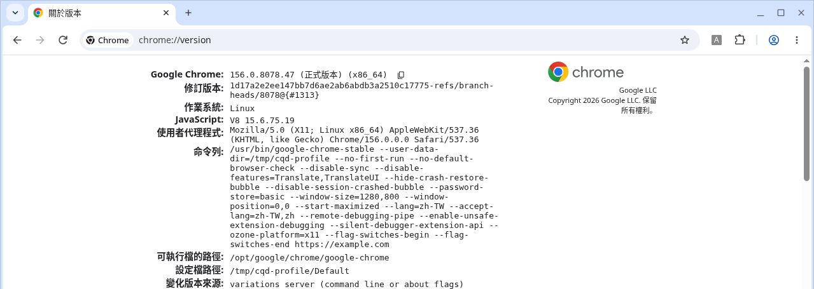

**繁體中文** | [English](DETAILS.en.md)

# 詳細說明

回到 [README](../README.md)。

## 它會改什麼、不會改什麼

**會做**

- Windows：備份後，把 `--silent-debugger-extension-api` 加到目前使用者桌面、公用桌面、開始功能表（個人與所有使用者），以及工作列釘選的 Chrome 捷徑。同時在 `HKCU` 覆寫 `ChromeHTML`（以及 Beta / Dev / Canary 等類似項目）的開啟指令，讓你點連結開啟 Chrome 時也會帶上這個參數。不需要系統管理員權限。
- macOS：在 `~/Applications` 建立一個名為 `Chrome (Quiet Debugger).app` 的啟動器。

同一個參數不會被加兩次。再跑一次安裝是安全的。Windows 可用 `.\windows\status.ps1` 查看目前狀態，或用 `.\windows\install.ps1 -WhatIf` 先預覽。備份在 `%USERPROFILE%\chrome-quiet-debugger-backup`；解除安裝時有備份就還原，沒有備份就只把參數拿掉。

如果「所有使用者」的桌面或開始功能表捷徑更新失敗，多半是權限不夠。你自己桌面上的捷徑，以及點連結時用的開啟指令，一般仍會改成功。

**不會做**

- 不修改 Chrome 的程式檔
- 不開啟 `--remote-debugging-port`
- 不安裝、移除或改設定任何擴充功能
- 不改 `chrome://flags`

## 不用腳本的作法

**Windows：** 在 Chrome 捷徑按右鍵 → `內容`，在「目標」裡 `chrome.exe` 路徑後面空一格，加上 `--silent-debugger-extension-api`。每個會打開 Chrome 的捷徑都要改。改完後完全結束 Chrome 再重開。只改捷徑的話，從連結開啟 Chrome（而且當時 Chrome 是關著的）可能還是不會帶上這個參數；腳本才會一併改登錄檔裡的開啟指令。

**macOS：** 先 `Cmd+Q` 結束 Chrome，然後在終端機執行：

```bash
open -a "Google Chrome" --args --silent-debugger-extension-api
```

之後若要常用，再跑 `./mac/install.sh` 做啟動器會比較方便。

## 限制

macOS 無法改掉「點連結時啟動 Chrome」這條路。如果 Chrome 已經完全結束，你再去點一個網頁連結，系統還是會用原本的 `Google Chrome.app` 啟動，這次就不會帶上參數。請先用啟動器打開 Chrome，之後再點連結，就會沿用已經帶參數的那個行程。

## 安全說明

這條提示是在告訴你：有擴充功能正在透過偵錯介面控制這個瀏覽器。上面的「取消」也可以立刻切斷這種控制。

加上 `--silent-debugger-extension-api` 之後，**所有**使用偵錯 API 的擴充功能都不會再顯示這條提示，不是只針對 Claude 或 Codex。請先確認你安裝的擴充功能都信得過，再使用這個工具。共用電腦、公司管理的電腦，或你不確定裝了哪些擴充功能時，不要用。

## 其他做法

- [thelabcorner/chrome-silent-debugger](https://github.com/thelabcorner/chrome-silent-debugger) 是類似的 Windows 工具，用的也是同一個啟動參數。
- 比較精準的作法是用企業政策 `ExtensionInstallForcelist` 強制安裝特定擴充功能。走這條路時，Chrome 本來就不會對「被政策強制安裝」的那個擴充功能顯示這條提示。不過要改系統層級的設定（通常需要系統管理員），而且那個擴充功能使用者不能自己移除；公司電腦也可能跟 IT 政策衝突。
- 有人在 Anthropic 的 issue 追蹤裡建議官方提供內建選項：[anthropics/claude-code#69287](https://github.com/anthropics/claude-code/issues/69287)。

## 關於這些截圖

[使用前／使用後的對照圖](before-after.png) 是用官方 Google Chrome 156.0.8078.47（正式版本，Linux x86_64、英文介面）拍的，臨時設定檔，沒有登入帳號。頁面是本機的英文 HTML，避免像 example.com 那樣出現其他語言。圖中是名稱設成「Claude/ChatGPT」的示範擴充功能，用來重現官方擴充功能會出現的提示條，並不是 Anthropic 或 OpenAI 的原版擴充功能。畫面上的文案是 `"Claude/ChatGPT" started debugging this browser`，右側有 `Cancel`。

官方商店的顯示名稱分別是：Anthropic 的 [Claude](https://chromewebstore.google.com/detail/claude/fcoeoabgfenejglbffodgkkbkcdhcgfn)，OpenAI 的 [ChatGPT](https://chromewebstore.google.com/detail/chatgpt/hehggadaopoacecdllhhajmbjkdcmajg)（manifest 為 `"name": "ChatGPT"`），不是 Codex。較早的 Codex 桌面版外掛，有使用者回報過看到 `"Codex"`，但現行商店版本不是這個名稱。對照圖把兩個名稱合在同一條提示上，方便一次看清楚。實際使用時，名稱會依你安裝的擴充功能而變。

在 `chrome://version` 的「命令列」裡，應該看得到 `--silent-debugger-extension-api`。下面這張是稍早拍的（介面為繁體中文），重點是命令列裡有這個參數：



那張命令列裡另外出現的 `--remote-debugging-pipe`、`--enable-unsafe-extension-debugging`，只是為了在官方 Chrome 156 載入示範擴充功能（這個版本會忽略 `--load-extension`），**不是**這個工具會加上的參數。
